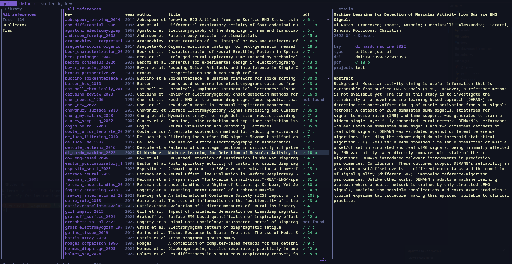
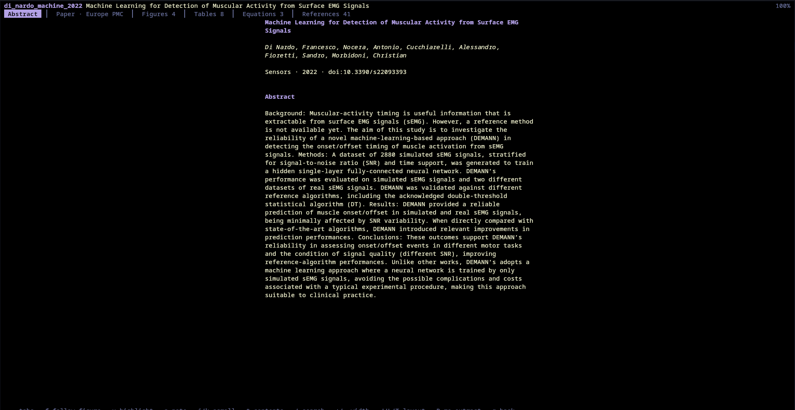
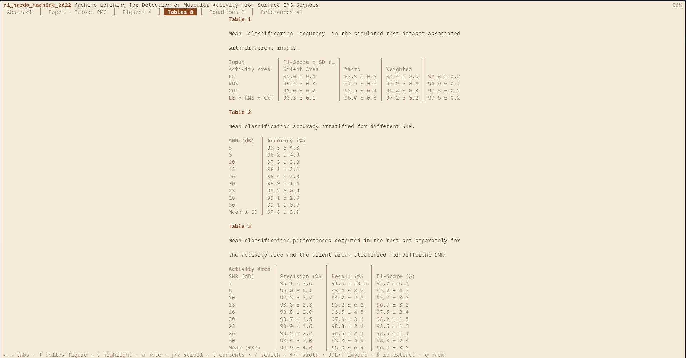
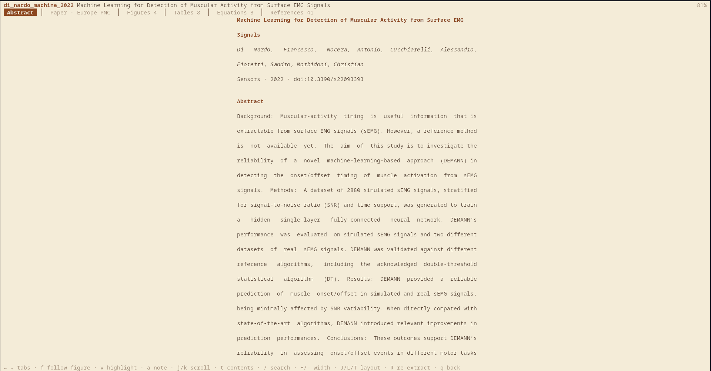

# quire

A reference manager written in Rust: a local library of references and PDFs, BibTeX/BibLaTeX and CSL-JSON
import and export, and metadata lookup by DOI. A quire is a gathered set of pages; here, a gathered set of sources.



## Status
A local reference library in the terminal (2026-10-20): add references by DOI, arXiv ID, PMID, PMCID or
URL (with fallback sources), check and fix their metadata, find and merge duplicates, organise them in
projects, tags and named libraries, download and check PDFs, read papers in the terminal (`quire tui`:
reader with figures, tables, equations, highlights and notes), search everything including the papers'
text, sync a library between devices (peer to peer over QUIC), save from the browser (extension in
`extension/`), export BibLaTeX, BibTeX, CSL-JSON or Hayagriva (Typst) files that stay up to date, check a
manuscript's citations (`quire folder check`), import a Zotero library (`quire import ~/Zotero`),
follow the citation graph (OpenAlex), watch arXiv, PubMed and Crossref (`quire alert`), check for
retractions, keep saved searches and a reading list, share projects with collaborators (each
with a role; everything else stays private), and back up a library to one file.
No desktop app yet. Documentation: the book in `docs/` (`mdbook serve docs`), published to GitHub
Pages by CI. Plan and decisions: `.knowledge/roadmap.md`.

| Reading a paper | Tables, reflowed | Themes |
|---|---|---|
|  |  |  |

```bash
cargo build -p quire-cli                     # binary: target/debug/quire
quire init                                   # create the default library; set the contact email
quire project new Thesis
quire project new "Chapter 2" --parent thesis
quire add 10.1038/nature12373 arXiv:1706.03762 pmid:31452104 -p thesis
quire list -p thesis -r                      # table; `--json` for scripts
quire ref check                              # metadata issues and failed lookups
quire ref edit vaswaniAttentionAllYou2017    # in $EDITOR; `ref refetch` keeps your edits
quire pdf get -p thesis -r                   # open-access PDFs; `--browser` for blocked ones

cd ~/papers/thesis
quire folder new -p thesis -r -o refs.bib    # quire.toml; refs.bib is rewritten after every change
quire add 10.1093/nar/gkaa1100               # goes into `thesis`, refs.bib updates
quire export --format hayagriva -o refs.yml --keep-updated

quire library new lab --path ~/sync/lab      # more libraries; `--lib lab` or `quire library use lab`
quire config keys                            # every setting, e.g. export profiles
```

Commands are grouped: `ref`, `project`, `library`, `tag`, `note`, `pdf`, `highlight`, `export`, `folder`,
`sync`, `config`, `saved`, `alert`; `add`, `list`, `show` and `search` stand alone. `quire tui` is the terminal interface;
`quire serve` is the local endpoint for the browser extension.

## Layout (as in lumen and dsp-kitchen)
| Path | Purpose |
|---|---|
| `crates/quire-model` | Domain types, no I/O: IDs, identifiers, references, creators, dates, projects |
| `crates/quire-io` | CSL-JSON, BibTeX/BibLaTeX (Typst's `biblatex`), Hayagriva export, edit format, PDF checks |
| `crates/quire-core` | Use cases (add, dedup, projects, export selection), cite keys, the `Library` port |
| `crates/quire-store` | SQLite storage: schema, migrations, `Library` implementation |
| `crates/quire-fetch` | Metadata and PDF lookup: doi.org, Crossref, arXiv, NCBI, Unpaywall, web pages |
| `crates/quire-engine` | Facade for every front end: config, libraries, files, exports, async API |
| `crates/quire-sync` | Sync between devices: session protocol, iroh (QUIC) transport |
| `crates/quire-server` | `quire serve`: local HTTP endpoint for a browser extension |
| `crates/quire-tui` | `quire tui`: library browser and reader (ratatui) |
| `extension/` | Browser extension (Manifest V3, Firefox and Chromium) |
| `crates/quire-cli` | The `quire` command line |
| `quire_py/` | Python SDK: PyO3 crate (`src/`, native module `quire_bindings`) + Python package `quire/`, tests |
| `playground/` | Experiments; `typst-test/`: Typst documents citing quire's exports |
| `docs/` | The book (mdBook); reference pages generated by `docs/gen-reference.sh` |
| `.github/workflows/` | CI (fmt, clippy, tests) and the book on GitHub Pages |
| `.knowledge/` | Notes, decisions, references |
| `assets/` | Icons, fonts, themes; `img/` screenshots (also in the book, via `docs/src/images`) |

## Toolchain
Rust 1.99 stable (`rust-version = "1.99"`).

## Python (maturin + uv)
`pyproject.toml` builds `quire_py` with maturin (as in lumen): native module `quire_bindings.quire_bindings`,
Python package `quire` (Python 3.13, `.python-version`).

```bash
uv sync                       # builds the Rust extension via maturin and installs it (editable)
uv run python -c "import quire; print(quire.__version__)"
uv run maturin develop --uv   # rebuild after Rust changes (add --release for speed)
uv run pytest -q quire_py/tests
```

## Name
`quire` is taken on crates.io (a YAML parser) and reserved on PyPI; it is fine for local use and prefixed crate
names (`quire-core`, ...). Choose a distinct published name before any release.

## License
[GNU Affero General Public License v3.0 or later](LICENSE) (AGPL-3.0-or-later). You may use,
change and self-host quire freely; if you offer it to others as a network service, you must make
your changes available under the same license.
